# OPEN-EDU — Hướng dẫn nhanh cho giáo viên

> Bàn làm việc giáo viên chạy trên trình duyệt (Chrome, Edge, Safari) ở máy tính, máy tính bảng hoặc điện thoại.
> Cài như ứng dụng: Chrome/Edge bấm ⋮ → **Cài đặt ứng dụng**; iPad: Chia sẻ → **Thêm vào MH chính**.

Menu bên trái gồm hai nhóm: **Dạy học** (Tổng quan, Bài giảng, Ngân hàng hoạt động, Giao bài, Lớp học, Kiến thức,
Trực tiếp) và **Đánh giá** (Bài viết, Chấm bài, Tiêu chí chấm, Nhận xét TT27, Thi đua, Điểm danh).

## 1. Đăng nhập
1. Mở địa chỉ app GV nhà trường cấp (vd `gv.truong.edu.vn`).
2. Nhập **tên đăng nhập** và **mật khẩu** — dùng đúng tài khoản app cũ OpenLMS.
3. Màn hình **Tổng quan** hiện việc cần làm hôm nay: bài chờ chấm, lớp chưa điểm danh, em cần quan tâm.

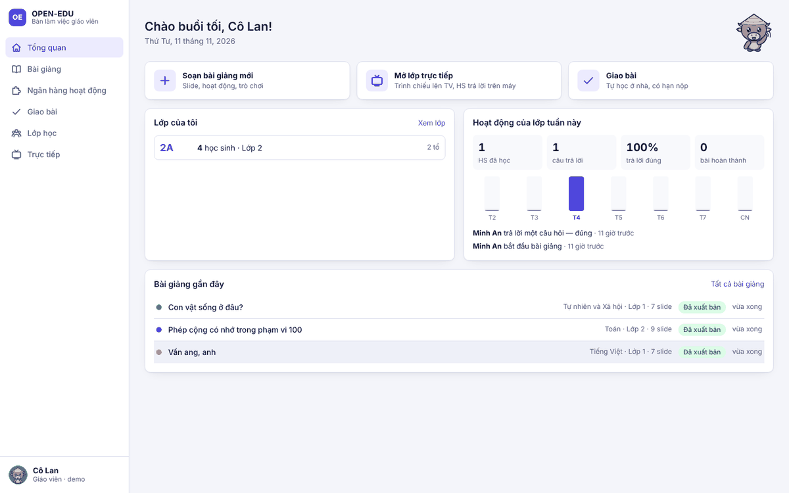

Quên mật khẩu → báo quản trị trường cấp lại. Không đăng nhập chung tài khoản với người khác.

## 2. Soạn bài giảng
1. **Bài giảng** → **Tạo bài**: chọn môn, khối, tên bài.
2. Thêm **slide**: chữ + hình, video, hoặc **hoạt động** (16 dạng: chọn đáp án, nối, kéo thả, sắp xếp, điền chỗ trống,
   nghe chọn, vẽ, đọc thành tiếng, que tính…).
3. Lấy câu hỏi có sẵn từ **Ngân hàng hoạt động** (gồm câu đã chuyển từ app cũ) hoặc bấm **AI gợi ý** để AI soạn
   nháp — **luôn đọc lại và sửa** trước khi dùng.
4. Bấm **Xem thử** như học sinh, rồi **Lưu / Xuất bản**.

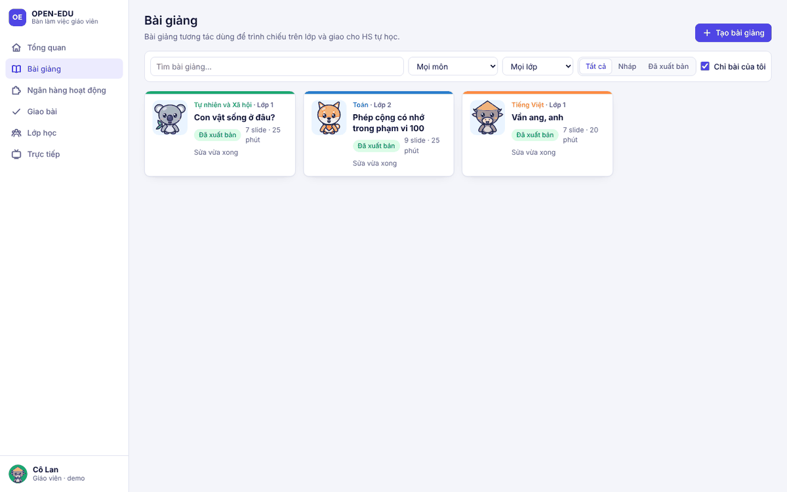
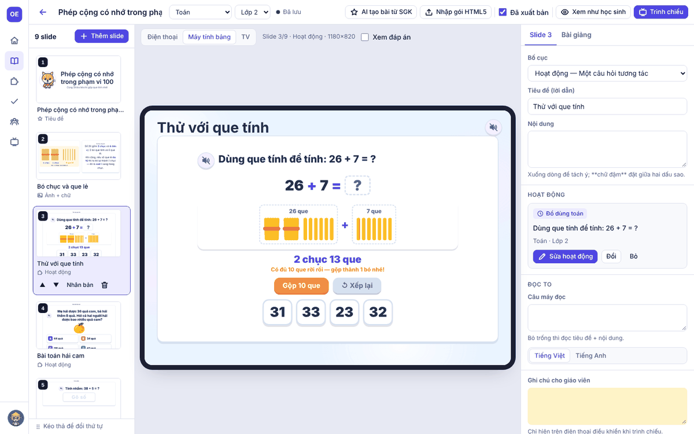

Mẹo: lớp 1–2 nên ≤ 6 slide, mỗi slide một ý; hoạt động có giọng đọc mẫu để em chưa đọc thạo vẫn làm được.

## 3. Dạy trực tiếp trên TV
1. **Trực tiếp** → chọn bài → **Bắt đầu**. App hiện **mã vào lớp 6 số** và **mã QR**.
2. Trên máy nối TV, bấm **Mở trên TV** (hoặc mở link TV) → TV hiện phòng chờ có mã QR.
3. Học sinh mở app trên máy tính bảng / điện thoại → **Vào lớp** → quét QR hoặc gõ mã 6 số.
4. Thầy/cô điều khiển bằng điện thoại/laptop: **Tiếp** sang slide, **Khóa** câu trả lời, **Công bố đáp án**, xem ai đã làm.
5. Kết thúc → TV hiện tổng kết; sao tự cộng cho em trả lời đúng.

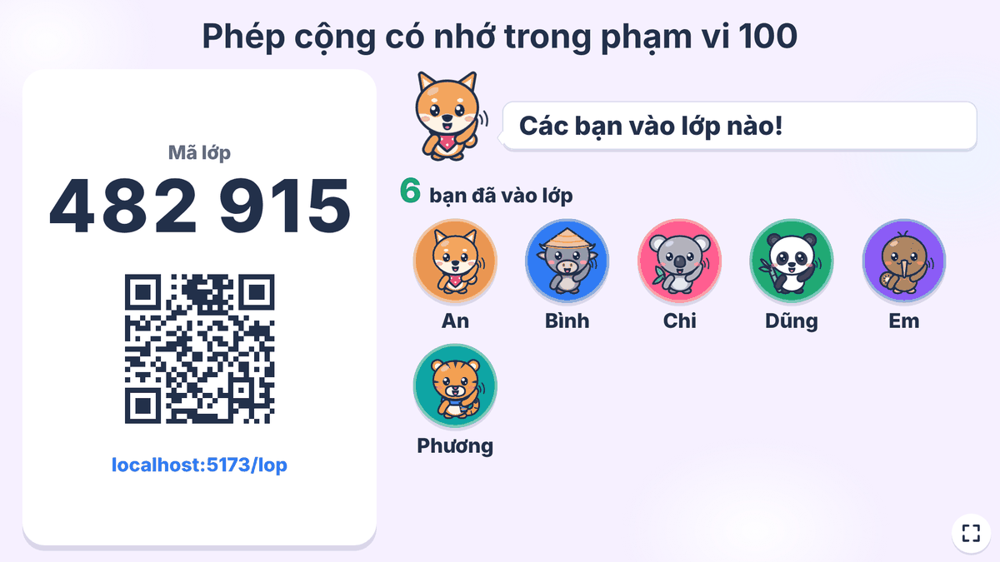
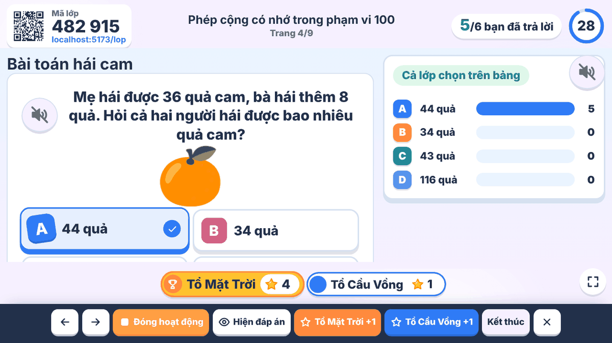

Mã hết hạn sau 12 giờ. Mạng yếu: chạy máy chủ lớp học trong LAN (nhờ quản trị, xem README).

## 4. Giao bài về nhà
1. **Giao bài** → chọn bài giảng hoặc bộ luyện tập → chọn **lớp** (hoặc vài em) → **hạn nộp** → **Giao**.
2. Theo dõi tiến độ ở **Lớp học** → từng em: đã mở, đã xong, số câu đúng.

## 5. Bài viết, chấm bài bằng AI và duyệt
**Giao bài viết**: **Bài viết** → **Tạo** → đề bài (+ ảnh), chọn **Tiêu chí chấm** (rubric) → giao lớp. HS nộp bằng
**chụp ảnh bài viết tay** (≤ 6 ảnh) hoặc gõ chữ; thầy/cô cũng có thể **nộp hộ** (chụp cả lớp một lượt).

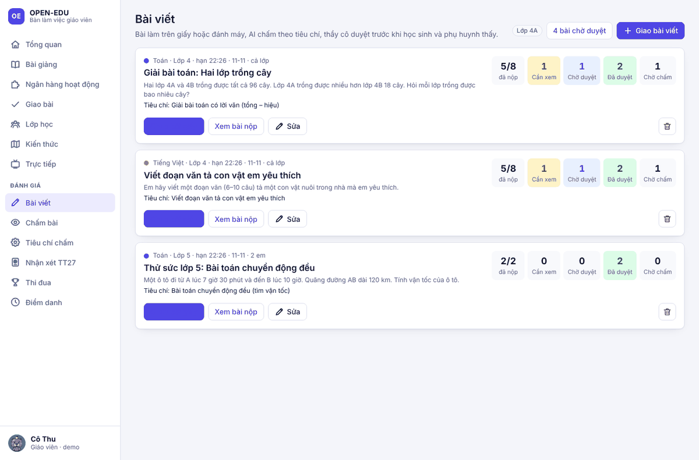

**AI chấm** ngay sau khi nộp: đọc chữ viết tay, cho điểm từng tiêu chí, mức **T / H / C**, lời nhận xét cho HS và phụ huynh.
Kết quả AI **chưa** đến tay HS/phụ huynh cho tới khi thầy/cô duyệt.

1. **Chấm bài** → hàng chờ (bài AI gắn cờ *Cần thầy/cô xem* nằm trên cùng).
2. Mở bài: bên trái ảnh bài làm + chữ AI đọc được; bên phải điểm và nhận xét từng tiêu chí.
3. Chọn một trong bốn nút:
   - **Duyệt** — đồng ý với AI.
   - **Sửa & duyệt** — chỉnh điểm/nhận xét rồi duyệt.
   - **Chấm lại** — AI chấm lại (vd sau khi sửa tiêu chí).
   - **Trả lại cho HS** — kèm lời nhắn, em làm lại.
4. Phím mũi tên ← → để sang bài kế.

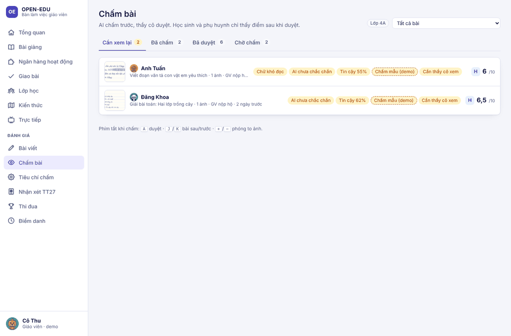
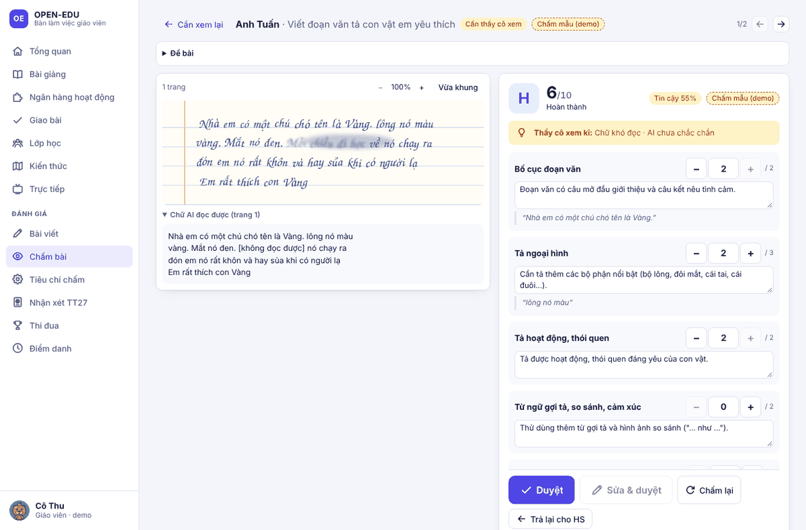

Lưu ý: chữ khó đọc, AI "tin cậy" thấp → luôn xem ảnh gốc. AI không nhận tên học sinh. Nhãn *Chấm mẫu (demo)* nghĩa là
chưa bật AI thật.

## 6. Nhận xét TT27
1. **Nhận xét TT27** → chọn lớp, kì (**GK1, CK1, GK2, CN**).
2. Bấm **Gợi ý từ dữ liệu** — app soạn nháp mức đạt môn học, phẩm chất, năng lực và nhận xét, kèm **Căn cứ gợi ý**
   (kĩ năng vững/cần ôn, bài viết đã duyệt).
3. **Sửa** cho đúng với em (thầy/cô là người quyết định), **Lưu** (nháp).
4. Khi chắc chắn: **Chốt chính thức** → HS và phụ huynh mới thấy. **Xem bản in** để in sổ.

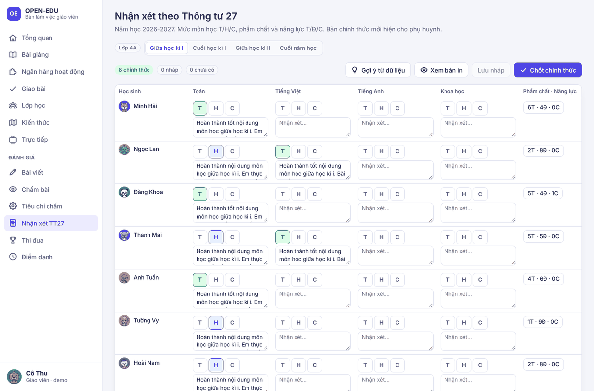

Nhận xét TT27 chuyển từ app cũ vào dưới dạng **nháp** — thầy/cô rà và chốt lại.

## 7. Thi đua
1. **Thi đua** → chọn em (hoặc **Chọn nhiều em** / **Theo tổ** / **Cả lớp**) → bấm hành vi (vd *Giúp bạn +2*).
2. Lỡ tay → **Hoàn tác** ngay trên thông báo.
3. **Sửa danh sách hành vi**: thêm *hành vi tích cực* / *điều cần cố gắng* (−5 … +5 sao).
4. **Bảng tuần này** để khen thưởng cuối tuần.

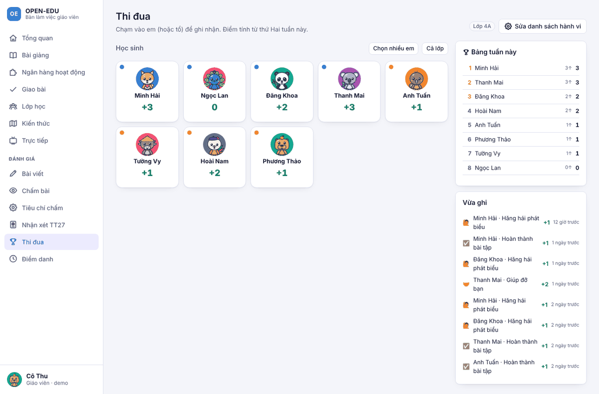

Điểm thi đua cũ đã quy đổi thành **sao đầu kỳ** của từng em.

## 8. Điểm danh
**Điểm danh** → ngày hôm nay → mặc định *Có mặt*, bấm vào em để đổi: **Vắng có phép / Vắng không phép / Muộn** →
**Lưu**. Phụ huynh thấy điểm danh của con.

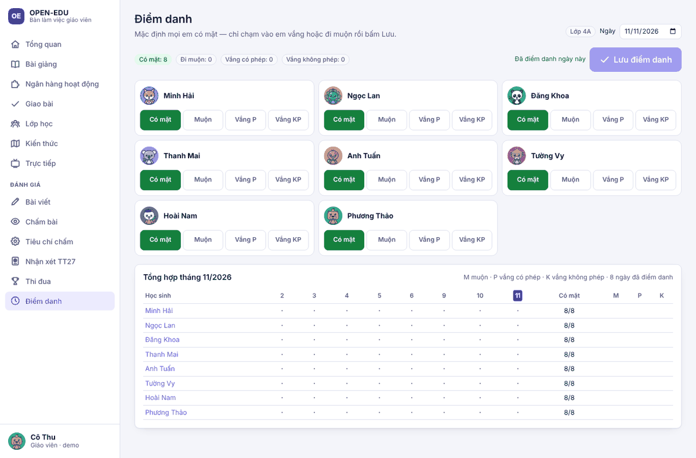

## 9. Đọc hồ sơ học sinh & bản đồ kiến thức (bảng nhiệt)
- **Kiến thức** → bản đồ lớp: mỗi hàng một em, mỗi cột một yêu cầu cần đạt.
  Màu: **Vững** (xanh đậm ✓) · **Đang học** (xanh nhạt) · **Cần ôn** (cam !) · **Chưa học** (trắng).
  Bấm ô để xem bằng chứng (câu đã làm, lỗi sai hay gặp) và **gốc rễ** (kĩ năng nền bị hổng).
- Sắp xếp **Nhiều lỗ hổng trước** để biết em cần giúp nhất.
- **Lớp học** → bấm tên em → **Hồ sơ**: tiến độ, kĩ năng, bài viết, thi đua, điểm danh, TT27.

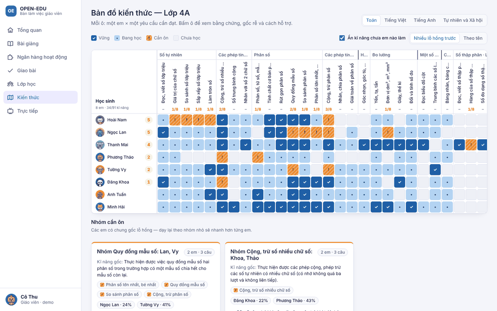
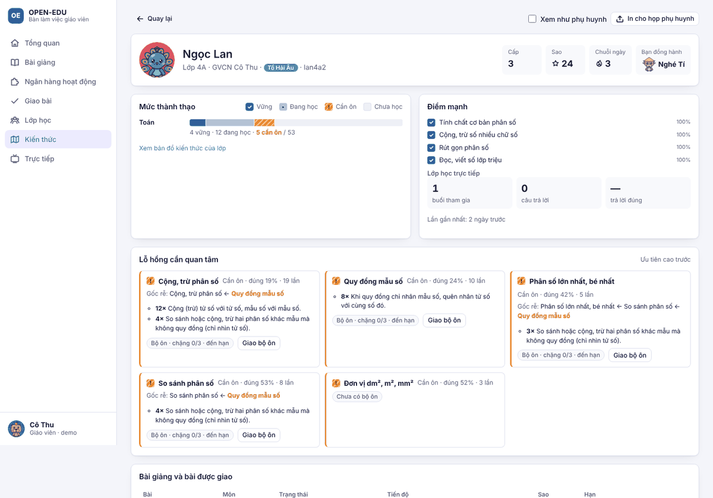

## 10. Vá lỗ hổng
- Dưới bản đồ, mục **Nhóm cần ôn** gom các em có **chung gốc lỗ hổng** (vd *Quy đồng mẫu số*). Dạy lại theo nhóm nhỏ 10 phút.
- Học sinh có lỗ hổng sẽ thấy nhiệm vụ **Vá lỗ hổng** ở Góc học tập: bài ôn ngắn từ kĩ năng gốc, có gợi ý từng bước.
  Làm đúng nhiều lần, ô trên bản đồ chuyển dần sang **Vững** — thầy/cô không phải giao tay.

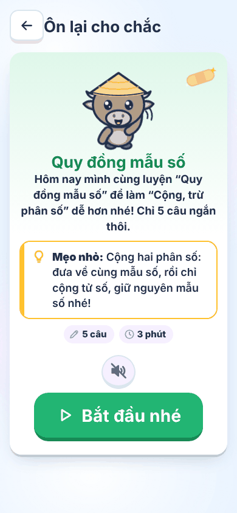

## Câu hỏi thường gặp
- **Bài cũ, điểm cũ ở đâu?** Câu hỏi, khóa học, sao thi đua, điểm bài kiểm tra, nhận xét TT27 đã chuyển sang. Lịch sử
  khác xem ở **app cũ** (chỉ xem) qua nút *Mở app cũ*.
- **HS không vào được lớp trực tiếp**: kiểm tra mã 6 số, cùng mạng Wi-Fi (nếu dùng máy chủ LAN), tải lại trang.
- **Phụ huynh thấy gì?** Chỉ con mình: sao, tiến độ, điểm danh, thi đua, bài viết **đã duyệt**, TT27 **đã chốt**.
- **Hỗ trợ**: nhóm Zalo "OPEN-EDU — Hỗ trợ GV", hoặc quản trị trường.
