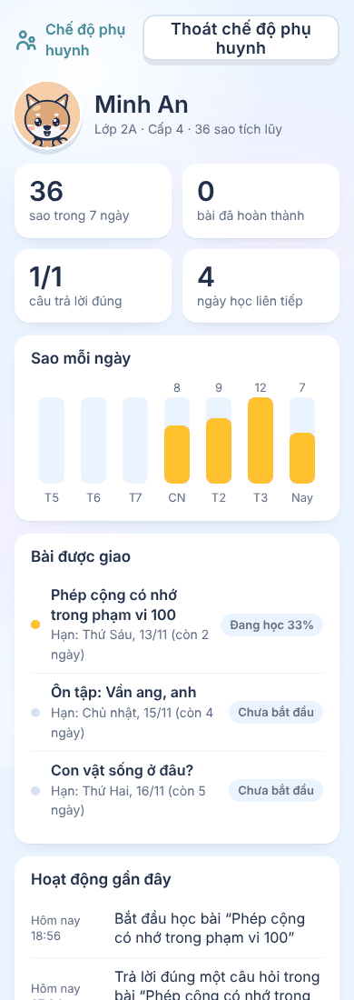

# OPEN-EDU — Hướng dẫn cho phụ huynh

**OPEN-EDU** là góc học tập của con trên điện thoại, máy tính bảng hoặc máy tính. Không có quảng cáo.

### 1. Vào app
- Mở địa chỉ nhà trường gửi (vd **hoc.truong.edu.vn**) hoặc tải app **OPEN-EDU** trên CH Play / App Store.
- Đăng nhập bằng **tài khoản phụ huynh** nhà trường cấp (vẫn dùng tài khoản app cũ nếu đã có).
- Con đăng nhập bằng **tài khoản của con** (thầy cô cấp).

### 2. Phụ huynh xem được gì
- ⭐ **Sao** con kiếm được và bạn linh vật con đã mở.
- 📚 **Bài đã học**, kĩ năng con đã **vững** / **cần ôn**.
- ✍️ **Bài viết** con nộp — chỉ sau khi **thầy cô đã duyệt**, kèm lời nhận xét và **một gợi ý giúp con ở nhà**.
- 🏅 **Thi đua** và 📅 **điểm danh** của con.
- 📝 **Nhận xét cuối kì (TT27)** khi thầy cô đã chốt.

Phụ huynh chỉ thấy **con mình**. Có nhiều con học ở trường → báo GVCN để liên kết thêm.

### 3. Giúp con ở nhà (10–15 phút/ngày)
1. Để con tự đăng nhập, tự chọn bài.
2. Khen khi con cố gắng, không chỉ khi đúng.
3. Thấy mục **Vá lỗ hổng** → cùng con làm, đọc gợi ý từng bước.
4. Bài viết tay: chụp **thẳng, đủ sáng, cả trang** rồi nộp.

### 4. Cần giúp?
Quên mật khẩu, chưa thấy con trong tài khoản → nhắn **GVCN** hoặc văn phòng nhà trường.
Nhà trường không bao giờ hỏi mật khẩu qua điện thoại.
